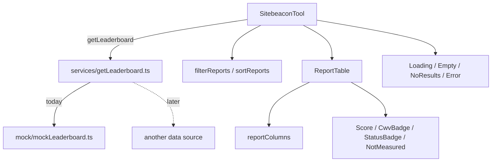

# sanity-plugin-sitebeacon

A Sanity Studio plugin that surfaces Sitebeacon website analysis inside Studio:
performance, accessibility, SEO, carbon and transfer data for a leaderboard's
URLs.

The plugin registers a custom Studio tool, **Sitebeacon Analysis**, which lists
every submitted URL and its per-device results, with search, filtering, sorting
and refresh.

---

## 1. Installation

```sh
npm install sanity-plugin-sitebeacon
```

## 2. Usage

Add it as a plugin in `sanity.config.ts` (or `.js`):

```ts
import {defineConfig} from 'sanity'
import {sitebeaconPlugin} from 'sanity-plugin-sitebeacon'

export default defineConfig({
  //...
  plugins: [sitebeaconPlugin()],
})
```

The plugin registers a tool named `sitebeacon-analysis`, shown as **Sitebeacon
Analysis** in the Studio navigation.

---

## 3. Architectural Summary

### Core highlights

- **Mock-first.** The dashboard runs entirely against local fixtures. No network
  call is made, so the UI can be built and reviewed on its own.
- **Data access is isolated.** Nothing in `src/components/` imports the mock.
  Components take props; `src/services/` is the single place data enters.
- **Missing data is never zero.** Every measured value is nullable, and a queued
  or failed scan renders `--` rather than `0`. This distinction is enforced in
  one helper (`whenScanned`) and one constant (`NOT_MEASURED`).
- **No third-party dependencies for UI.** `@sanity/ui` ships no table, no chart
  and no pagination primitive, so the table and its cells are plain semantic
  HTML. The only runtime dependency is `@sanity/ui` itself.

### Data flow

```
Sanity Studio tool  (SitebeaconTool)
        │
        ├─ filter → sort          utils/reports.ts
        ├─ render table           components/ReportTable.tsx
        │     └─ cell columns     components/reportColumns.tsx
        └─ states                 components/states.tsx
                │
        services/getLeaderboard.ts     ← the only data entry point
                │
        mock/mockLeaderboard.ts        ← today, the only data source
        another data source            ← later, behind the same function
```



---

## 4. Directory Structure & File Manifest

### Plugin source (`src/`)

| Path                               | Purpose                                                                                                                                                                                                                                                                                       |
| :--------------------------------- | :-------------------------------------------------------------------------------------------------------------------------------------------------------------------------------------------------------------------------------------------------------------------------------------------- |
| `src/index.ts`                     | Plugin entry point. `definePlugin` registers the `sitebeacon-analysis` tool.                                                                                                                                                                                                                  |
| `src/tool/SitebeaconTool.tsx`      | The Studio tool: fetch state, filter/sort state, and the loading / empty / no-results / error branches.                                                                                                                                                                                       |
| `src/types/index.ts`               | The data contract. `SitebeaconResponse`, `Leaderboard`, `UrlReport`, `DeviceReport`, `Metrics`, `Resource`, `AccessibilitySummary`, plus `DeviceStrategy`, `CwvAssessment`, `ResourceType`.                                                                                                   |
| `src/services/getLeaderboard.ts`   | Data access. `getLeaderboard()` returns the response envelope. Another data source replaces this file only.                                                                                                                                                                                           |
| `src/mock/mockLeaderboard.ts`      | Fixtures. Four responses — `mixed`, `completed`, `empty`, `error` — exported as `mockResponses`.                                                                                                                                                                                              |
| `src/utils/format.ts`              | Formatting and missing-data helpers: `NOT_MEASURED`, `normalizeStatus`, `formatValue`, `formatCarbon`, `formatKilobytes`, `formatEnergy`, `formatBytes`, `formatUrlLabel`, `getCarbonTone`, `getCarbonRating`, `getCwvLabel`, `getDevice`, `getMetric`, `compareNullable`, `sumTransferSize`. |
| `src/utils/reports.ts`             | Pure list logic: `sortValue`, `sortReports`, `filterReports`. No JSX.                                                                                                                                                                                                                         |
| `src/components/ReportTable.tsx`   | The table: `<table>`, `<thead>`, `<tbody>`, and the `HeaderCell` / `DataCell` / `ReportRow` primitives. Knows layout, not content.                                                                                                                                                            |
| `src/components/reportColumns.tsx` | `COLUMNS`, the single declaration of every column that drives both the header and the rows.                                                                                                                                                                                                   |
| `src/components/Score.tsx`         | Cell primitives: `Score`, `CwvBadge`, `StatusBadge`, `NotMeasured`, `badgeTone`.                                                                                                                                                                                                              |
| `src/components/Toolbar.tsx`       | Device toggle, search, status filter, sort menu, refresh.                                                                                                                                                                                                                                     |
| `src/components/states.tsx`        | `LoadingState`, `ErrorState`, `EmptyState`, `NoResultsState`.                                                                                                                                                                                                                                 |

### Package configuration

| File                                   | Purpose                                                                                                                                                                       |
| :------------------------------------- | :---------------------------------------------------------------------------------------------------------------------------------------------------------------------------- |
| `package.json`                         | Package definition: exports (`source` → `./src/index.ts`, `default` → `./dist/index.js`), scripts, and peer dependencies (`sanity ^5 \|\| ^6`, `react`, `styled-components`). |
| `tsconfig.json` / `tsconfig.dist.json` | Type checking and the distribution build config.                                                                                                                              |
| `package.config.ts`                    | `@sanity/pkg-utils` build settings.                                                                                                                                           |
| `oxlint.config.ts` / `oxfmt.config.ts` | Lint and format configuration from `@sanity/plugin-kit`.                                                                                                                      |

### Workspace

| Path                                        | Purpose                                                                  |
| :------------------------------------------ | :----------------------------------------------------------------------- |
| `../sitebeacon-dev-studio/`                 | The development Studio that loads the plugin locally.                    |
| `../sitebeacon-dev-studio/sanity.config.ts` | Registers `sitebeaconPlugin()` alongside the structure and vision tools. |

---

## 5. Data Contract

This is **this plugin's own contract**, declared in `src/types/index.ts`. There is
no Sitebeacon API wired up: `getLeaderboard()` reads fixtures from
`src/mock/mockLeaderboard.ts` and nothing else. The types describe what the
dashboard is allowed to render, so they stay the single boundary between "data
we have" and "components that draw it".

If a real source is added later, it is added behind `getLeaderboard()` and must
satisfy the types below — no component changes.

### The shape

```ts
SitebeaconResponse {
  leaderboard: Leaderboard | null    // null on failure
  error_message: string | null
}

Leaderboard {
  id, leaderboard_name, status, created_at
  results_ready_at: string | null
  total_urls, completed_urls, failed_urls, processing_urls
  items: UrlReport[]
}

UrlReport {
  submitted_url, normalized_url, display_domain, status, url_report_id
  image_url: string | null
  updated_at: string | null
  is_green_hosting: boolean | null
  average_carbon_emission, average_energy, kilobytes_transferred   // URL level
  desktop: DeviceReport | null
  mobile: DeviceReport | null
}

DeviceReport {
  strategy, cwv_assessment, carbon_emission
  perf, acs, seo, bp                    // Lighthouse scores, 0-100
  field_metrics: Metrics | null
  lab_metrics: Metrics | null
  resources: Resource[] | null
  accessibility_summary: AccessibilitySummary | null
}

Resource { label, requestCount, resourceType, transferSize, carbonEmission }

AccessibilitySummary {
  violation_count, assisted_count, tags: string[]
  severity_counts { critical?, serious?, moderate?, minor? }
}
```

### Three details that are easy to misread

These are encoded in the types and fixtures on purpose — do not simplify them:

1. **`cwv_assessment` is `'Passed' | 'Failed' | 'N/A'`.** `'N/A'` is a real
   value, distinct from a device that was never scanned (`desktop: null`).
2. **`severity_counts` omits keys whose count is zero.** A device with no
   critical issues has no `critical` key at all, so all four keys are optional.
3. **`field_metrics` is a full `Metrics` object or `null`** — not a reduced
   field-only shape — and individual values inside it can still be `null`.

### Units

| Field                                                                      | Unit         |
| :------------------------------------------------------------------------- | :----------- |
| `average_carbon_emission`, `carbon_emission`, `resources[].carbonEmission` | grams CO₂e   |
| `average_energy`                                                           | kW           |
| `kilobytes_transferred`                                                    | kilobytes    |
| `resources[].transferSize`                                                 | bytes        |
| `lab_metrics.fcp/lcp/ttfb/speed_index/time_to_interactive`                 | seconds      |
| `lab_metrics.total_blocking_time`, `field_metrics.inp`                     | milliseconds |
| `cls`                                                                      | unitless     |
| `perf`, `acs`, `seo`, `bp`                                                 | 0-100        |

### Invariants the fixtures preserve

Two relationships hold on every device in the fixture data, and the code relies
on them:

- `sum(severity_counts) === violation_count`
- `carbon_emission === sum(resources) - resources[third-party]`

Third-party carbon is reported but excluded from the page total. Summing every
resource to reproduce `carbon_emission` therefore overshoots.

### URL-level and device-level figures do not reconcile

`average_carbon_emission`, `average_energy` and `kilobytes_transferred` are
historical aggregates across page views. `carbon_emission`, `perf` and
`resources` come from the latest scan. They are different measurements: the mean
of the two device values is **not** the URL value, and `kilobytes_transferred`
is not the sum of the device `transferSize` figures. Do not derive one from the
other.

### Deliberately not modelled

| Not modelled                       | Why                                                                                                             |
| :--------------------------------- | :-------------------------------------------------------------------------------------------------------------- |
| accessibility **score** per device | No such field. `DeviceReport` returns `perf`, `acs`, `seo`, `bp`; accessibility is reported as issue **counts** |
| a `weight`/`severity` field        | Not present; severity only exists as `severity_counts`                                                          |
| pagination metadata                | `getLeaderboard()` returns the whole leaderboard at once                                                         |

### Missing data is never zero

Every measured value is nullable, and `null` is rendered as `--`:

- `getDevice()` returns `null` for a device that was never scanned.
- `whenScanned()` in `reportColumns.tsx` is the single guard that turns an
  unscanned device or failed scan into `NotMeasured`.
- Lighthouse scores render as plain text; **carbon is the only colour-coded
  metric** (`getCarbonTone`: < 0.493 g good, < 0.656 g caution, else critical),
  matching the banding used in `getCarbonTone`.
- `compareNullable()` sorts `null` last **in both directions**, so an unmeasured
  URL can never top the table.
- `normalizeStatus()` lowercases before comparing, because `status` is a
  free-form string and casing is not guaranteed.

---

## 6. Mock Data

`src/mock/mockLeaderboard.ts` holds seven URLs covering every scan state. `/`
carries the awkward cases on purpose: microsecond timestamps, long floats,
`cwv_assessment: 'N/A'` on mobile, and a desktop `severity_counts` with no
`critical` key. The rest are invented but hold the same shape.

| URL                                   | Status     | Exercises                          |
| :------------------------------------ | :--------- | :--------------------------------- |
| `/`                                   | completed  | both devices, no real-user data    |
| `/blog`                               | completed  | real-user data on both devices     |
| `/pricing/enterprise?plan=annual&...` | completed  | long URL with a query string       |
| `/portfolio`                          | completed  | poor scores, video-heavy resources |
| `/services`                           | processing | no device results yet              |
| `/about`                              | queued     | nothing measured                   |
| `/careers`                            | failed     | nothing measured                   |

Four ready-made responses let each UI state be inspected:

```ts
import {getLeaderboard} from './services/getLeaderboard'

await getLeaderboard() // 'mixed' - all seven URLs
await getLeaderboard({fixture: 'completed'}) // finished scans only
await getLeaderboard({fixture: 'empty'}) // no URLs submitted
await getLeaderboard({fixture: 'error'}) // leaderboard is null
```

To read one report, look it up in the list rather than fetching it separately.
`getLeaderboard()` returns every URL at once, so a per-report request would
re-fetch the whole leaderboard:

```ts
import {findReport} from './utils/reports'

const report = findReport(leaderboard.items, urlReportId) // UrlReport | null
```

---

## 7. Development Guide

From the repository root:

```sh
pnpm dev:plugin  # pkg-utils watch - rebuilds dist on every src change
pnpm dev         # sanity dev in sitebeacon-dev-studio
pnpm typecheck   # tsc --noEmit across the workspace
pnpm lint        # oxlint in the plugin
pnpm build       # plugin-kit verify-package + pkg-utils build
pnpm verify      # plugin-kit verify-package
```

**Run `pnpm dev:plugin` in a second terminal alongside `pnpm dev`.** The Studio
resolves the package through its `default` export condition (`./dist/index.js`),
not `source` (`./src/index.ts`), so edits under `src/` are invisible until `dist`
is rebuilt. This is the most common cause of "my change did nothing".

This plugin uses [@sanity/plugin-kit](https://github.com/sanity-io/plugins/tree/main/packages/@sanity/plugin-kit)
with default configuration for build and watch scripts. See
[Testing a plugin in Sanity Studio](https://github.com/sanity-io/plugins/tree/main/packages/@sanity/plugin-kit#testing-a-plugin-in-sanity-studio).

---

## 8. Status

| Area                                  | State                                                                   |
| :------------------------------------ | :---------------------------------------------------------------------- |
| Data contract                         | Defined in `src/types/index.ts`, fixture-backed                          |
| Mock provider                         | Complete, seven URLs across every scan state                            |
| Report listing                        | Complete — table, search, status filter, sort, refresh                  |
| Desktop/mobile                        | Device **toggle** (one device at a time), not a side-by-side comparison |
| Lab and field metrics                 | **Not surfaced yet** — present in the contract, not rendered            |
| Resources and accessibility breakdown | **Not surfaced yet** — the table shows the violation total only         |
| Report detail view                    | **Not built** — listing only                                            |
| Pagination                            | **Not implemented** — one response holds every URL                      |
| Automated tests                       | **None** — no runner configured. Lint, typecheck and build pass         |

### Pagination

**Not implemented.** The table renders every row that survives filtering and
sorting.

`getLeaderboard()` returns the whole leaderboard in a single response, so there
is nothing to page over at the data level. Paging would have to be done
client-side, slicing the list **after** filtering and sorting so the page count
reflects what is actually visible:

```
filter → sort → slice → render
```

---

## 9. Security

Sanity Studio is a client-side application. Anything in this package, or in any
environment variable read at build time, is shipped to the browser.

- Nothing secret is held today: the dashboard reads local fixtures and makes no
  network request.
- **Do not add an API key to this package or to `sanity.config.ts`.** Anything
  added there is readable in the browser.
- If a real data source later needs a credential, it must be called through a
  server-side proxy. Studio cannot hold a secret.

---


## License

[MIT](LICENSE) © Shahadat Hossain
